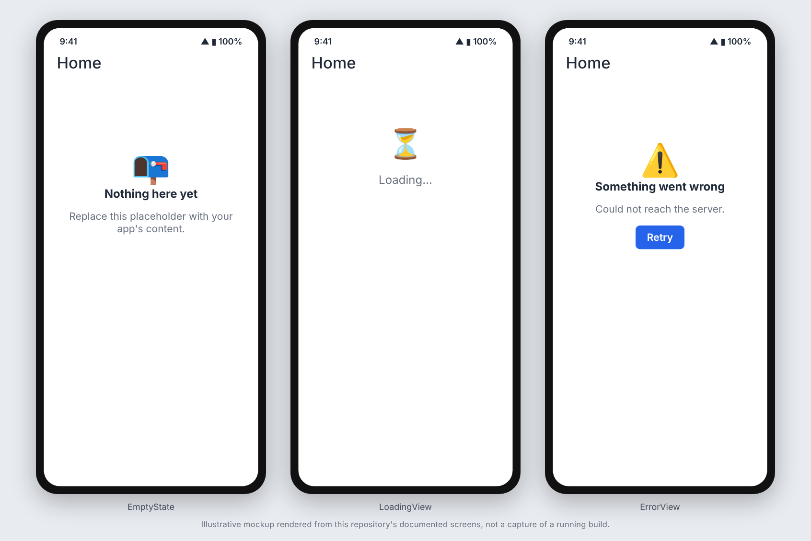

# Flutter starter

A Flutter app skeleton with the plumbing most apps need and none of the domain code.

## Screenshots



_These images are illustrative mockups rendered from this repository's documented screens and API shapes, not captures of a running build. Regenerate or replace them with real captures once the app is running._

## What is included

- `lib/config/env.dart`: build-time config via `--dart-define=API_BASE_URL=...`.
- `lib/api/api_client.dart`: JSON client on `package:http` with a typed `ApiException`
  (`{"error": "CODE", "message": "..."}` bodies) and optional bearer token.
- `lib/services/secure_store.dart`: token storage in Keychain/Keystore via `flutter_secure_storage`.
- `lib/services/reminder_scheduler.dart`: local scheduled notifications with a configurable Android channel,
  POST_NOTIFICATIONS prompt, and inexact alarms (see the comment for why).
- `lib/app_services.dart` + `lib/main.dart`: one `AppServices` bundle built in `main()` and provided via `Provider`.
- `lib/theme/app_theme.dart`: `AppTheme.light`/`AppTheme.dark` (Material 3, one seed color), wired into
  `MaterialApp` in `main.dart`.
- `lib/widgets/`: shared UI: `AppButton` (full width, `loading` spinner), `AppTextField` (with `errorText`),
  `ErrorView` (message plus optional Retry), `LoadingView`, `EmptyState` (optional action). The home screen
  uses `EmptyState`. Tests: `test/widgets/shared_widgets_test.dart`.
- `test/support/`: `FakeSecureStoragePlatform` and `FakeReminderScheduler`, plus unit and widget tests.
- `integration_test/`: a real-`main()` startup test, a reminder-delivery test, and `reboot_probe_main.dart`
  (an entry point, not a test) for the reboot check.
- `.github/scripts/`: emulator helpers (auto-tap the permission dialog, run integration tests, check that a
  reminder survives a reboot).
- `.github/workflows/`: `ci.yml` (format, analyze, test), `android-native.yml` (Gradle build + emulator),
  `android-native-skip.yml` (required-check workaround for docs-only PRs), `security.yml`
  (gitleaks, CodeQL for Actions, osv-scanner on `pubspec.lock`), plus `dependabot.yml`.

## Use the template

```bash
./rename.sh my_app "My App" com.acme.my_app
# fill in LICENSE, then:
flutter pub get
dart format lib test integration_test
flutter analyze        # must print "No issues found!"
flutter test
```

Android needs an `android/local.properties` with `flutter.sdk` (created by `flutter pub get`/`flutter run`).
Release signing is not configured: `android/app/build.gradle.kts` signs release builds with the debug key until you
add your own signing config. Never commit keystores or `key.properties`.

## Notes

- CodeQL has no Dart pack, so `flutter analyze` is the only static analysis of `lib/`.
- If you add a plugin that needs a `FragmentActivity` (some payment SDKs, for example), change `MainActivity`
  to extend `FlutterFragmentActivity`.
- Durable project context goes in `docs/project-memory/`.
